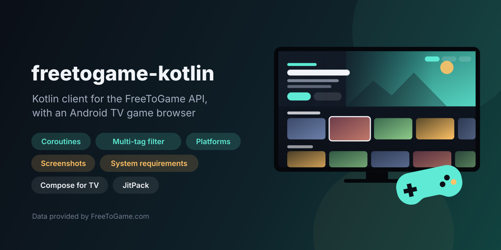
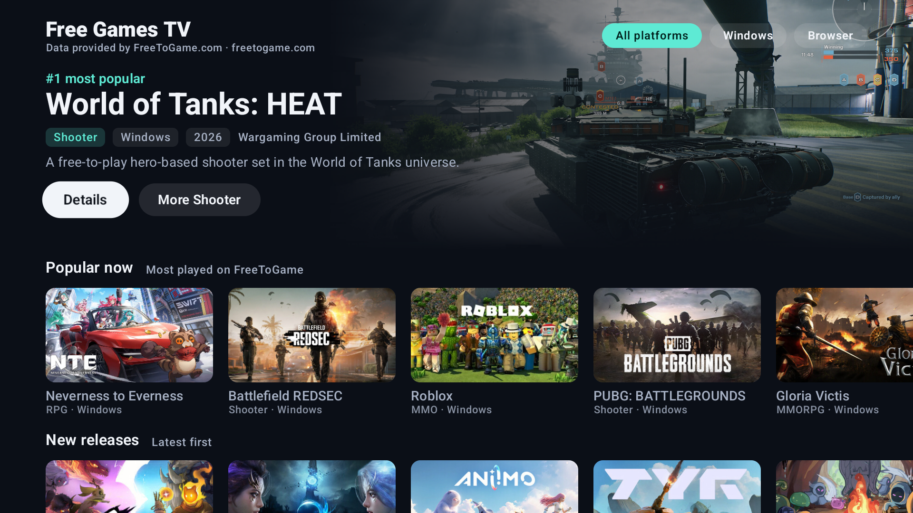
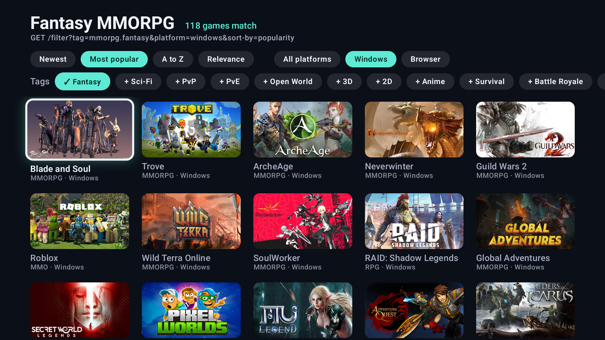
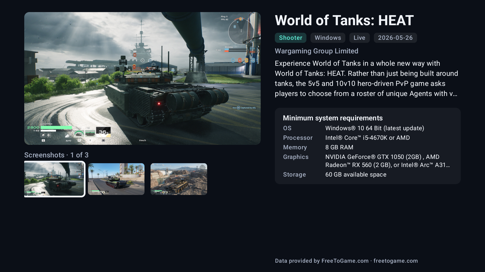

<p align="center">
  
</p>

<p align="center">
  <a href="https://github.com/halilozel1903/freetogame-kotlin/actions/workflows/ci.yml"></a>
  <a href="https://jitpack.io/#halilozel1903/freetogame-kotlin"></a>
  
  
  
  
  <a href="LICENSE"></a>
</p>

**freetogame-kotlin** is a Kotlin coroutine client for the [FreeToGame API](https://www.freetogame.com/api-doc), the free-to-play games database. It covers the whole API: `/games` with platform, category and sort order, `/filter` with several tags combined, and `/game?id=` with typed screenshots and minimum system requirements. It recognises Cloudflare challenge pages and reports them as an error instead of decoding them, keeps responses in memory for a few minutes and spaces requests to stay under FreeToGame's limit of 10 per second. The library is pure Kotlin/JVM (Ktor and kotlinx.serialization). The sample app is an Android TV game browser built with Compose for TV.

```kotlin
val client = FreeToGameClient()

val shooters = client.games(platform = Platform.Windows, category = GameTag.Shooter, sortBy = SortBy.Popularity)
shooters.first().title                       // the most popular Windows shooter
shooters.first().thumbnail                   // https://www.freetogame.com/g/<id>/thumbnail.jpg

// GET /filter?tag=3d.mmorpg.fantasy.pvp&platform=windows
val mmos = client.filter(GameTag.ThreeD, GameTag.Mmorpg, GameTag.Fantasy, GameTag.Pvp, platform = Platform.Windows)

val game = client.game(mmos.first().id)
game.screenshots.map { it.image }            // full-size screenshot urls
game.minimumSystemRequirements?.graphics     // null for most browser games
```

> **Data provided by [FreeToGame.com](https://www.freetogame.com).** FreeToGame's terms require this attribution, with a link, wherever its data is shown. The sample app shows it on every screen, and the client exposes the text as `FreeToGameClient.ATTRIBUTION`.

## Screenshots

CI captures these from the sample app on an Android TV emulator (1080p). The data and images come from the live FreeToGame API. If a request or an image fails, or FreeToGame answers with a Cloudflare challenge, the job fails and the old screenshots stay.

**Home:** the most popular game in the hero banner, the platform filter, and rails for popular games, new releases and each genre.



**Genre:** fantasy MMORPGs for Windows, from `GET /filter?tag=mmorpg.fantasy&platform=windows`, with sort, platform and tag chips.



**Details:** the screenshot gallery, facts, the description and the minimum system requirements.



## Features

- **Every endpoint:** `games(platform, category, sortBy)`, `filter(tags, platform, sortBy)` and `game(id)`.
- **Typed parameters:** `Platform` (Windows, Browser, All), `SortBy` (release date, popularity, alphabetical, relevance) and `GameTag` with a constant for each of the 45 documented categories and tags. Any other tag still works through `GameTag("…")`.
- **Typed models:** `Game` for lists. `GameDetails` adds the status, the description (`paragraphs`), `screenshots` and `minimumSystemRequirements`. Helpers parse `platforms` and `releaseDate`, and `requirementsOrNull` gives the labelled requirements that have a value.
- **Cloudflare aware:** a challenge or block page (a `cf-mitigated: challenge` header, or an HTML page with Cloudflare's challenge markup) throws `FreeToGameException.Blocked`. It is never decoded, never cached and never retried.
- **"No results" handled:** FreeToGame answers a query with no matches with a status object instead of a list. The client returns an empty list for it, and throws `NotFound` for a missing game.
- **Polite by default:** requests are spaced to stay under 10 per second, responses are cached in memory for 5 minutes, and network errors and 5xx responses are retried with backoff.
- **Testable:** pass any Ktor engine (`MockEngine` in tests) or replace HTTP with a `FreeToGameTransport`.

### API coverage

| Function | Request | Returns |
| --- | --- | --- |
| `games()` | `GET /games` | `List<Game>` |
| `games(platform = Platform.Browser)` | `GET /games?platform=browser` | `List<Game>` |
| `games(category = GameTag.Shooter)` | `GET /games?category=shooter` | `List<Game>` |
| `games(sortBy = SortBy.Alphabetical)` | `GET /games?sort-by=alphabetical` | `List<Game>` |
| `games(Platform.Browser, GameTag.Mmorpg, SortBy.ReleaseDate)` | `GET /games?platform=browser&category=mmorpg&sort-by=release-date` | `List<Game>` |
| `filter(GameTag.ThreeD, GameTag.Mmorpg, GameTag.Fantasy, GameTag.Pvp, platform = Platform.Windows)` | `GET /filter?tag=3d.mmorpg.fantasy.pvp&platform=windows` | `List<Game>` |
| `game(452)` | `GET /game?id=452` | `GameDetails` |
| `details(game)` | `GET /game?id={game.id}` | `GameDetails` |
| `gamesUrl(…)`, `filterUrl(…)`, `gameUrl(id)` | none: they build the url | `String` |

## Installation

Add JitPack to `settings.gradle.kts`:

```kotlin
dependencyResolutionManagement {
    repositories {
        google()
        mavenCentral()
        maven("https://jitpack.io")
    }
}
```

Then add the dependency:

```kotlin
dependencies {
    implementation("com.github.halilozel1903.freetogame-kotlin:freetogame:1.0.0")

    // Optional: use OkHttp instead of Ktor's CIO engine (recommended on Android).
    implementation("io.ktor:ktor-client-okhttp:3.6.0")
}
```

> The build is also set up for Maven Central (`io.github.halilozel1903:freetogame`) through the vanniktech publish plugin.

`freetogame` is a plain Kotlin/JVM library (JDK 17+), so it works in server and desktop projects too. `releaseDate` uses `java.time`. On Android below API 26, enable [core library desugaring](https://developer.android.com/studio/write/java8-support#library-desugaring) or read `releaseDateText`.

## Usage

### Create a client

```kotlin
val client = FreeToGameClient {
    engine = OkHttp.create()            // default: CIO
    retries = 2                         // network errors and 5xx, with exponential backoff
    requestTimeoutMillis = 30_000
    cacheTtlMillis = 5 * 60_000         // 0 turns the in-memory cache off
    maxRequestsPerSecond = 10           // FreeToGame's limit; 0 turns pacing off
}
// ...
client.close()
```

### Lists

```kotlin
val all = client.games()                                          // every live game
val browser = client.games(platform = Platform.Browser)
val newest = client.games(sortBy = SortBy.ReleaseDate)
val racing = client.games(Platform.Windows, GameTag.Racing, SortBy.Popularity)

val game = racing.first()
game.genre            // "Racing"
game.platforms        // setOf(Platform.Windows)
game.releaseDate      // LocalDate?, null for "0000-00-00"
game.profileUrl       // the game's page on FreeToGame
```

### Several tags

`filter` sends the tags joined with `.`. It only lists games that have every tag. A combination that matches nothing returns an empty list.

```kotlin
val tags = listOf(GameTag.Mmorpg, GameTag.Fantasy, GameTag.Pvp)
val games = client.filter(tags, platform = Platform.Windows, sortBy = SortBy.Popularity)
```

### Details, screenshots and requirements

```kotlin
val details = client.game(452)
details.status                        // "Live"
details.paragraphs                    // the description, split into paragraphs
details.screenshots                   // List<Screenshot(id, image)>
details.minimumSystemRequirements     // SystemRequirements(os, processor, memory, graphics, storage)?
details.requirementsOrNull?.entries   // [("OS", "Windows 10 64-bit"), ("Memory", "8 GB RAM"), ...]
```

### Errors

```kotlin
try {
    client.game(id)
} catch (e: FreeToGameException.Blocked) {
    // Cloudflare answered with a challenge page (e.status). Try later, or from another network.
} catch (e: FreeToGameException.NotFound) {
    // No game with this id.
} catch (e: FreeToGameException.Network) {
    // Offline, timeout or DNS.
} catch (e: FreeToGameException) {
    // Http (other status codes) or Decoding.
}
```

## Sample app

`sample/` is an Android TV app built with Compose for TV (`androidx.tv:tv-material`) and Coil:

- **Home:** a hero banner for the most popular game, using its first screenshot. A platform filter (All, Windows, Browser) reloads every rail. Rails show popular games, new releases and six genres, and each genre rail ends with a card that opens the whole genre.
- **Genre:** a grid with sort chips, platform chips and tag chips. Adding tags switches from `/games?category=` to `/filter?tag=`, and the request is shown under the title.
- **Details:** a screenshot gallery (the focused thumbnail fills the viewer), facts, the description and the minimum system requirements.

Every screen loads the live API. There is no bundled or fallback data, and errors are shown with a retry button.

The screenshot scenes open with `adb shell am start -n io.github.halilozel1903.freetogame.sample/.MainActivity --es scene home|genre|detail`. A scene logs `SCENE_READY` once its data and every image on screen have loaded. It logs `SCENE_FAILED` when a request or an image fails, including a Cloudflare challenge. `scripts/screenshots.sh` waits for these lines.

## Cloudflare

FreeToGame is served through Cloudflare. A data-center IP, a VPN or an unusual client can get a challenge page instead of JSON. The client never treats that page as data: it throws `FreeToGameException.Blocked`. In the sample, a challenge fails the screenshot scene, so CI fails rather than publishing an error screen or made-up data.

## Project structure

```
freetogame/   Kotlin/JVM client (published)
sample/       Android TV app (Compose for TV)
scripts/      Screenshot capture for CI
```

## Tech stack

Kotlin 2.4, coroutines, Ktor 3.6, kotlinx.serialization, Compose for TV 1.1, Coil 3, AGP 9.4, Gradle 9.6.

## Legal

This is an unofficial client. It is not affiliated with FreeToGame or its parent company. Game names, images and descriptions belong to their owners. Data provided by [FreeToGame.com](https://www.freetogame.com).

## License

MIT. See [LICENSE](LICENSE).
